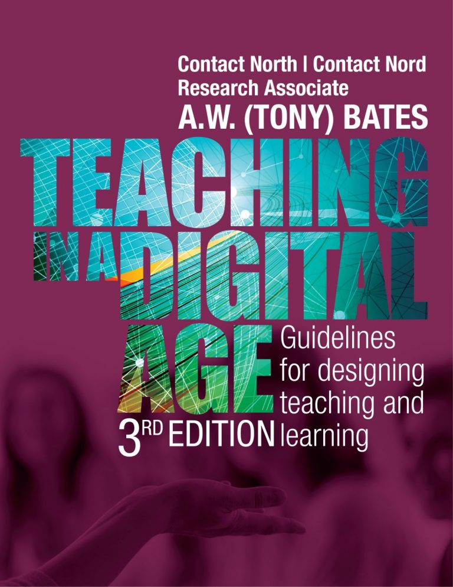

# Teaching in a Digital Age: Third Edition - General

Guidelines for designing teaching and learning

A.W. (Tony) Bates

[CC BY-NC 4.0](https://creativecommons.org/licenses/by-nc/4.0/ ":class=navpill")

[Start Reading](section-1/scenario-a-1-a-university-professor-addresses-chan.md ":class=button :class=primary")

> [!IMPORTANT]
> **Teaching in a Digital Age: Third Edition - General – Imported from Pressbooks**
>
>
> **Authors:** A.W. (Tony) Bates | **License:** CC BY-NC 4.0 | **141 pages**
>
> [View original on Pressbooks](https://pressbooks.bccampus.ca/tonybates/)
>
>

The book examines the underlying principles that guide effective teaching in an age when all of us, and in particular the students we are teaching, are using technology. A framework for making decisions about your teaching is provided, while understanding that every subject is different, and every instructor has something unique and special to bring to their teaching. The book enables teachers and instructors to help students develop the knowledge and skills they will need in a digital age: not so much the IT skills, but the thinking and attitudes to learning that will bring them success. Book release date (third edition): 18 August, 2022. For subsequent updates, see Updates and Revisions in the front matter of the book.

## [Front Matter](section-1/scenario-a-1-a-university-professor-addresses-chan.md) <!-- {docsify-ignore} -->

Accessibility, about, preface, and acknowledgements.

## [Chapter 1: Fundamental Change in Education](section-2/README.md) <!-- {docsify-ignore} -->

## [Chapter 2: The nature of knowledge and the implications for teaching](section-3/README.md) <!-- {docsify-ignore} -->

## [Chapter 3: Methods of teaching: campus-focused](section-4/README.md) <!-- {docsify-ignore} -->

## [Chapter 4: Methods of teaching with an online focus](section-5/README.md) <!-- {docsify-ignore} -->

## [Chapter 5: MOOCs](section-6/README.md) <!-- {docsify-ignore} -->

## [Chapter 6: Building an effective learning environment](section-7/README.md) <!-- {docsify-ignore} -->

## [Chapter 7: Understanding technology in education](section-8/README.md) <!-- {docsify-ignore} -->

## [Chapter 8: Pedagogical differences between media](section-9/README.md) <!-- {docsify-ignore} -->

## [Chapter 9: Emerging technologies](section-10/README.md) <!-- {docsify-ignore} -->

## [Chapter 10: Choosing and using media in education](section-11/README.md) <!-- {docsify-ignore} -->

## [Chapter 11: Modes of delivery](section-12/README.md) <!-- {docsify-ignore} -->

## [Chapter 12: Trends in open education](section-13/README.md) <!-- {docsify-ignore} -->

## [Chapter 13: Ensuring quality teaching in a digital age](section-14/README.md) <!-- {docsify-ignore} -->

## [Chapter 14: Supporting teachers and instructors in a digital age](section-15/README.md) <!-- {docsify-ignore} -->

## [15. The book in a nutshell](section-16/README.md) <!-- {docsify-ignore} -->

## [Appendix 1: Questions to guide media selection and use](section-17/README.md) <!-- {docsify-ignore} -->

## [Appendix 2 Online learning quality standards, organisations and research](section-18/README.md) <!-- {docsify-ignore} -->

## [Appendix 3: Independent reviews](section-19/README.md) <!-- {docsify-ignore} -->

## [Appendix 4: Feedback on Activities](section-20/appendix-4-feedback-on-activity-19-main-conclusion.md) <!-- {docsify-ignore} -->

## [Back Matter](section-21/bibliography.md) <!-- {docsify-ignore} -->

Appendices, bibliography, and versioning history.

**[Start Reading →](section-1/scenario-a-1-a-university-professor-addresses-chan.md)**

Teaching in a Digital Age: Third Edition - General by A.W. (Tony) Bates © 2022 is licensed under <a href="https://creativecommons.org/licenses/by-nc/4.0/">CC BY-NC 4.0</a>.

<!-- Hides the sidebar on this page -->

